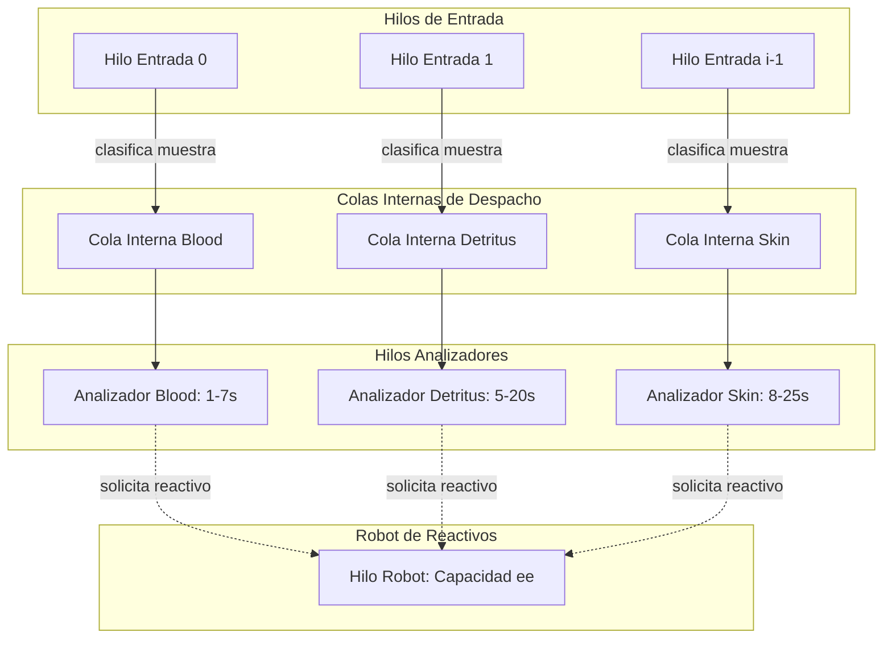

# 3. Estructuras de Control de Concurrencia, Sincronización y Prevención de Bloqueos

Este documento aborda el modelo formal de concurrencia del sistema, fundamentado directamente en los principios teóricos del curso de Sistemas Operativos:
- **Problema del Búfer Acotado (*Bounded-Buffer*)** con semáforos contadores y binarios.
- **Criterios de la Sección Crítica:** Exclusión mutua, progreso y espera acotada (*bounded waiting*).
- **Manejo de Bloqueos Mutuos (*Deadlocks*)** y condiciones de Coffman en la gestión de recursos limitados (Robot de reactivos).

---

## 3.1. Modelo Productor-Consumidor en las Colas de Entrada

Cada una de las $i$ bandejas de entrada se protege mediante tres semáforos POSIX con nombre (`sem_open`):

1. **`sem_in_mutex[k]` (Semáforo Binario, valor inicial: `1`):**
   Garantiza **exclusión mutua** sobre los punteros `head`, `tail` y `count` de la cola $k$.
2. **`sem_in_empty[k]` (Semáforo Contador, valor inicial: `ie`):**
   Lleva la cuenta de las **ranuras libres** en la bandeja $k$. Si la cola está llena (`0`), el proceso productor (`evaluator reg`) se bloquea en `wait()` hasta que se libere un espacio.
3. **`sem_in_full[k]` (Semáforo Contador, valor inicial: `0`):**
   Lleva la cuenta de las **muestras disponibles** en la bandeja $k$. Si la cola está vacía (`0`), el hilo despachador del `evaluator` se bloquea en `wait()` esperando muestras.

### Protocolo de Inserción (Productor: `evaluator reg`):
```text
wait(sem_in_empty[k]);       // Espera por ranura libre
wait(sem_in_mutex[k]);       // Entrada a sección crítica

  cola[k].slots[cola[k].tail] = nueva_muestra;
  cola[k].tail = (cola[k].tail + 1) % ie;
  cola[k].count++;

signal(sem_in_mutex[k]);     // Salida de sección crítica
signal(sem_in_full[k]);      // Notifica muestra disponible
```

### Protocolo de Extracción (Consumidor: Hilos de Entrada del `evaluador`):
```text
wait(sem_in_full[k]);        // Espera por muestra disponible
wait(sem_in_mutex[k]);       // Entrada a sección crítica

  muestra = cola[k].slots[cola[k].head];
  cola[k].head = (cola[k].head + 1) % ie;
  cola[k].count--;

signal(sem_in_mutex[k]);     // Salida de sección crítica
signal(sem_in_empty[k]);     // Notifica espacio libre
```

---

## 3.2. Modelo Productor-Consumidor en la Cola de Salida

De manera simétrica, la bandeja de salida utiliza:
- **`sem_out_mutex` (Binario, inicial: `1`):** Exclusión mutua al insertar o extraer resultados.
- **`sem_out_empty` (Contador, inicial: `oe`):** Controla el límite de resultados pendientes. Impide desbordamiento de memoria.
- **`sem_out_full` (Contador, inicial: `0`):** Notifica a `evaluator rep` cuando hay resultados listos.

---

## 3.3. Concurrencia Interna del Proceso `evaluador`

El proceso `evaluador` (servidor) gestiona internamente varios hilos de ejecución (o *goroutines* en Go):



1. **Hilos de Entrada ($i$ hilos):** Un hilo escucha permanentemente cada bandeja externa de entrada $k \in [0, i-1]$. Extrae la muestra y la enruta a la cola interna correspondiente según su tipo (`B`, `D`, o `S`).
2. **Colas Internas ($q$ slots cada una):** Protegidas por canales sincronizados en Go o mutex internos. Aíslan el ritmo de entrada del ritmo de procesamiento.
3. **Hilos Analizadores (3 hilos):** Uno por cada tipo de examen:
   - **Blood:** Consumo aleatorio de tiempo $1 \dots 7$ seg.
   - **Detritus:** Consumo aleatorio de tiempo $5 \dots 20$ seg.
   - **Skin:** Consumo aleatorio de tiempo $8 \dots 25$ seg.
   - Verifican que haya reactivo disponible antes de iniciar. Si no hay suficiente, suspenden la atención de esa muestra y emiten solicitud de recarga al robot.

---

## 3.4. El Robot de Reactivos: Análisis y Prevención de Bloqueos Mutuos (*Deadlocks*)

### Análisis de las 4 Condiciones de Coffman:
1. **Exclusión Mutua:** El robot es un recurso único; solo puede atender a un analizador y transportar un tipo de reactivo a la vez.
2. **Retención y Espera (*Hold and Wait*):** Un analizador retiene una muestra mientras espera a que el robot le suministre reactivo.
3. **No Apropiación (*No Preemption*):** El reactivo asignado a un analizador o cargado en el robot no puede ser confiscado.
4. **Espera Circular:** Podría ocurrir si el robot esperara por reactivos y los analizadores esperaran indefinidamente por el robot sin atender nuevos comandos.

### Mecanismo de Prevención y Evasión:
- **Cola FIFO de Solicitudes al Robot:** Los analizadores encolan solicitudes en un buzón de pedidos hacia el robot. El robot atiende estrictamente en orden de llegada (FIFO), eliminando la posibilidad de inanición (*starvation*).
- **No-Bloqueo del Almacén Central:** Si el almacén central no tiene reactivo, el robot entra en espera de una señal de recarga que llega cuando el usuario invoca `evaluator ctrl update {B|D|S} <cant>`.
- **Exclusión en el Analizador durante la Recarga:** Cuando el robot llega al analizador, adquiere un cerrojo exclusivo sobre el tanque de dicho analizador para recargarlo de forma atómica.

---

## 3.5. Garantía de Espera Acotada (*Bounded Waiting*) y Prevención de Inanición

El PDF estipula: *"la muestra no puede permanecer en un estado de espera por siempre"*.

Para garantizar este requisito:
1. **Marca de Tiempo de Registro (`timestamp_reg`):** Cada muestra guarda el momento exacto en que ingresó al sistema.
2. **Política de Despacho con Envejecimiento (*Aging*):**
   Si una muestra permanece en cola interna por más de un umbral $T_{\text{max}}$ (por defecto 30 segundos), su prioridad se eleva a **urgente**, haciendo que el analizador procese esta muestra antes que muestras más recientes, garantizando que el tiempo de espera sea estrictamente finito y acotado.
